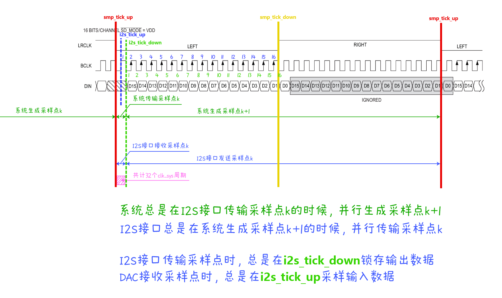

# MT-EMI 项目 Stage 1 开发计划

2026.10.27 最后一次修订

## 1. 项目概述

### 1.1. 时钟模块

项目可能用到以下时钟。其中，所有的 `always` 语句块都只以 `clk_sys` 时钟信号为敏感信号。

| 时钟信号 | 频率 | 用途 |
| --- | --- | --- |
| `clk_core` | 50 MHz | FPGA 片上自带时钟 |
| `clk_sys` | 98.304 MHz | 系统主时钟，由 PLL 产生 |

项目内部包含大量事件脉冲（`tick`），这类脉冲信号总是与 `clk_sys` 时钟信号同步，并且一次脉冲仅持续一个 `clk_sys` 时钟周期。它们的作用是负责提醒接口什么时候该做什么事情。下面列出一些常用的事件脉冲信号及其含义。

| 事件脉冲信号 | 频率 | 含义 |
| --- | --- | --- |
| `i2s_tick` | 1.536 MHz | I2S 通信事件脉冲 |
| `smp_tick` | 48 kHz | 音频采样事件脉冲 |
| `scan_tick` | 12 kHz | 外设扫描事件脉冲 |

事件脉冲是由时钟信号分频并做跳变检测得到的，因此有上跳变 `tick_up` 和下跳变 `tick_down` 两种事件脉冲。通常来讲，`tick_up` 事件脉冲用于触发某个动作，而 `tick_down` 事件脉冲用于通信场景下数据的锁存。

### 1.2. 常见信号定义

下面的接口定义中总是会反复地出现功能类似的信号。为了方便理解，下面列出这些信号的定义。

| 信号 | 方向 | 功能 |
| --- | --- | --- |
| `valid` | 输出 | 表示发送端数据有效的信号 |
| `ready` | 输入 | 表示接收端准备好接收数据的信号 |

考虑到模块可能同时要承担输入和输出的功能，因此对信号添加前缀

| 信号 | 方向 | 功能 |
| --- | --- | --- |
| `in_valid` | 输入 | 输入有效信号，本模块作为接收端时，外部模块提供的有效信号 |
| `in_ready` | 输出 | 输入准备好信号，本模块作为接收端时，向外部模块提供的准备好信号 |
| `out_valid` | 输出 | 输出有效信号，本模块作为发送端时，向外部模块提供的有效信号 |
| `out_ready` | 输入 | 输出准备好信号，本模块作为发送端时，外部模块提供的准备好信号 |

通常来讲，模块 A 向模块 B 发送数据时，接线满足 `A.out_valid -> B.in_valid`，`A.out_ready <- B.in_ready`。两信号分别记为 `valid` 和 `ready`，它们的交互过程如下：

1. 模块 A 产生数据，锁存到输出寄存器上，并将 `valid` 信号拉高，表示数据有效。
2. 模块 B 忙完自己的事，并且想要获取数据时，将 `ready` 信号拉高，表示自己准备好接收数据。注：步骤 1、2 没有先后之分。
3. 模块 A 检测到 `valid && ready` 为真时，认为数据已经传输完毕，将 `valid` 信号拉低（非阻塞赋值），表示数据已经被接收端拿走了。
4. 模块 B 检测到 `valid && ready` 为真时，立刻拿取并锁存数据到自己的输入寄存器上，开始忙自己的事情，将 `ready` 信号拉低（非阻塞赋值）。注：步骤 3、4 在同一个时钟上跳变发生。

### 1.3. 开发建议

定点运算约定：

- 音频 `SQ1.15`：16 位有符号，范围 `[-1, 1)`；控制量 `UQ0.16`：16 位无符号，最大值 `16'hFFFF` 略小于 1。
- 插值系数 `UQ1.15`：限定为 `16'h0000`～`16'h8000`，分别表示 0～1。
- 无符号系数参与有符号乘法前，用 `$signed({1'b0, coeff})` 零扩展为 17 位；16×17 乘积用 33 位 signed 保存。增益乘法算术右移 16 位，插值乘法算术右移 15 位恢复音频小数位数。接口无需扩位，本器件的 27×18 DSP 可容纳该乘法，实际映射以综合报告为准。
- 32 路 SQ1.15 采样求和至少用 21 位有符号累加器，调整增益后饱和为 16 位输出。

下面提供的开发模块接口设计和功能描述仅供参考，开发者可以根据自己的实际情况进行修改，但一定要写好注释并在群里进行同步说明。

每个模块都要写好测试模块，测试模块的文件名为 `xxx_tb.vt`，其中 `xxx` 为被测试模块的模块名。测试内容自定，但是要足够有效。如果某个模块不太好写测试的话，群里说一下我们一起讨论。

每个模块都要新建一个 `feat-xxx` 分支进行开发，其中 `xxx` 是模块名。开发完成后提交 PR 到 `dev` 分支。我会对代码进行审查，主要从接口设计和测试结果方面进行审查。审查通过后会进行合并。

开发中遇到的所有问题与困难均可以在群里进行讨论。

## 2. 外设驱动模块

### 2.1. 按键驱动模块

文件：`drivers/keyboard_driver.v`

功能：扫描按键，输出按键的状态。

```verilog
module keyboard_driver
#(
    parameter KEY_NUM = 24,
    parameter DEBOUNCE_TICKS = 98304  // 消抖时间，单位为系统周期数
)(
    input ...,  // 系统时钟、复位信号、按键输入引脚等
    input scan_tick_up,
    input out_ready,
    output [KEY_NUM-1:0] key_states,  // 按键状态，1 表示按下，0 表示未按下
    output [15:0] key_velocity [KEY_NUM-1:0],  // 按键按下的力度，UQ0.16 定点数[0,1)
    output out_valid
)
```

注意按键需要消抖。根据题目要求，消抖时间不宜过长，视实际情况进行调整。

还需要开发 `drivers/button_driver.v` 模块，用于扫描按钮，输出按钮的状态。该模块的接口设计与 `keyboard_driver` 模块类似，只不过不需要输出按键按下的力度。

### 2.2. 旋钮驱动模块

文件：`drivers/knob_driver.v`

功能：扫描旋钮，输出旋钮的状态。

```verilog
module knob_driver
#(
    parameter KNOB_NUM = 8,
    parameter DEBOUNCE_TICKS = 98304
)(
    input ...,  // 系统时钟、复位信号、旋钮输入引脚等
    input scan_tick_up,
    input out_ready,
    output [KNOB_NUM-1:0] knob_states,  // 旋钮状态，1 表示旋转，0 表示未旋转
    output [KNOB_NUM-1:0] knob_dirs,  // 旋钮旋转方向，1 表示顺时针，0 表示逆时针
    output [KNOB_NUM-1:0] knob_pressed,  // 旋钮按下状态，1 表示按下，0 表示未按下
    output out_valid
)
```

旋钮的旋转方向通过 AB 相检测进行计算；旋钮的按下状态需要消抖处理。

### 2.3. 弯音轮驱动模块

文件：`drivers/pitch_bend_driver.v`

功能：扫描弯音轮，输出弯音轮的弯音值。

```verilog
module pitch_bend_driver
#(
    parameter BEND_NUM = 1,
    parameter DEBOUNCE_TICKS = 98304
)(
    input ...,  // 系统时钟、复位信号、滑条输入引脚等
    input scan_tick_up,
    input out_ready,
    output [15:0] bend_value [BEND_NUM-1:0],  // 弯音轮滑动的值，UQ0.16 定点数 [0,1)
    output out_valid
)
```

`bend_value` 表示滑条的滑动值，范围为 [0, 1) 的定点数。

### 2.4. I2S 音频驱动模块

文件：`drivers/i2s_driver.v`

功能：通过 I2S 接口输出音频数据。

```verilog
module i2s_driver
(
    input ...,  // 系统时钟、复位信号等
    input i2s_tick_up,
    input i2s_tick_down,
    input smp_tick_up,
    input signed [15:0] audio_data,  // 音频数据输入，单声道信息，SQ1.15 定点数
    input in_valid,
    output i2s_bclk,  // I2S 位时钟输出
    output i2s_lrck,   // I2S 通道输出
    output i2s_dout,   // I2S 数据输出
    output in_ready
)
```

开发者需要学习一下 I2S 通信协议的相关知识，可参考 [I2S 协议](https://zhuanlan.zhihu.com/p/678943329) 了解 I2S 的工作原理。

这里给出我们系统的 I2S 通信协议时序图：



## 3. 音频信号生成模块

### 3.1. 三振荡器相位组模块

文件：`audio/detuned_phase_group.v`

功能：每个复音声部生成一个基础相位和两个对称失谐相位。

```verilog
module detuned_phase_group
#(
    parameter VOICE_NUM = 32  // 复音声部数
)(
    input ...,  // 系统时钟、复位信号等
    input smp_tick_up,  // 每个采样周期更新一次相位
    input [VOICE_NUM-1:0] note_on,  // 高电平时对应声部五个相位均重置为 0
    input [31:0] freq [VOICE_NUM-1:0],  // 音符频率，UQ16.16 Hz
    input out_ready,
    input in_valid,
    output [11:0] out_phase [VOICE_NUM*3-1:0],  // 每声部三路 UQ0.12 相位
    output out_valid,
    output in_ready
)
```

每个声部的三路顺序为基础、约 -12 音分、约 +12 音分。两路频率偏移固定，不随 `detune` 改变。`note_on` 使三路相位从 0 开始。相位组逐路更新声部相位，共用运算电路；`detune` 仅在后级合成器中控制混合权重。即使 `detune` 为 0，两路失谐相位也继续运行，以便演奏过程中增加失谐占比。

虽然 `out_phase` 只有 12 位，但在相位累加器的内部工作中，相位位宽要尽可能宽，这样才能得到准确的频率输出。之所以输出用小位宽，是因为 ROM 查找表的位深不能太深。

### 3.2. 包络发生器组模块

文件：`audio/envelope_group.v`

功能：产生包络数据的模块

```verilog
module envelope
#(
    parameter ENVELOPE_NUM = 32  // 即复音数
)(
    input ...,  // 系统时钟、复位信号等
    input smp_tick_up,  // 包络发生器应当在每个采样周期下推出一个音量值
    input [19:0] attack_ticks,  // attack 时间，单位为采样周期数
    input [19:0] decay_ticks,  // decay 时间，单位为采样周期数
    input [15:0] sustain_level,  // sustain 音量，UQ0.16 定点数 [0, 1)
    input [19:0] release_ticks,  // release 时间，单位为采样周期数
    input [ENVELOPE_NUM-1:0] note_on,  // 包络触发信号，高电平表示音频触发
    input [ENVELOPE_NUM-1:0] note_off,  // 包络释放信号，高电平表示音频释放
    input out_ready,
    input in_valid,
    output [15:0] volume [ENVELOPE_NUM-1:0],  // 包络输出的音量值，UQ0.16 定点数 [0, 1)
    output [ENVELOPE_NUM-1:0] note_busy,  // 发生器工作状态，高电平表示正在工作，低电平表示工作结束
    output out_valid,
    output in_ready
)
```

在 `note_on` 事件发生时，包络发生器由 `attack` 阶段开始，逐渐过渡到 `sustain` 阶段；在 `note_off` 事件发生时，包络发生器由 `sustain` 阶段过渡到 `release` 阶段，最终回到静音状态。

`note_busy` 信号表示包络发生器的工作状态，高电平表示正在工作，低电平表示工作结束。这个信号比较重要，因为它可以用来判断包络发生器是否已经完成了整个音频的播放过程，从而决定是否可以解除振荡器的占用。

### 3.3. 波表合成模块

文件：`audio/wavetable_synthesizer.v`

功能：将相位累加器组和包络发生器组组合起来，输出音频信号的模块

```verilog
module wavetable_synthesizer
#(
    parameter OSC_NUM = 32
)(
    input ...,  // 系统时钟、复位信号等
    input smp_tick_up,  // 波表合成器应当在每个采样周期下推出一个采样点
    input [11:0] phase [OSC_NUM*3-1:0],  // 每声部三路相位，UQ0.12
    input [15:0] volume [OSC_NUM-1:0],  // 包络发生器输出的音量值，UQ0.16 定点数
    input [15:0] detune,  // UQ0.16，0 时只取基础振荡器
    input [3:0] wavetable_0,  // 波形插值端点 0
    input [3:0] wavetable_1,  // 波形插值端点 1
    input [15:0] wavetable_interp,  // 波形插值系数，UQ1.15 定点数 [0, 1]
    input out_ready,
    input in_valid,
    output signed [15+$clog2(OSC_NUM):0] audio_out,  // 32 声部时为 21 位 SQ6.15
    output out_valid,
    output in_ready
)
```

波表合成模块用两路插值器、两批读取每声部的三个采样点。令基础采样点为 `C`，两路固定失谐采样点之和为 `S`，通常输出采样点为 `C + detune × (S - 2C) / 4`。`detune` 为 0 时严格得到基础采样点；最大编码值 `16'hffff` 特别按 `C + (S - 2C) / 4` 计算，使主音总权重与两路失谐音总权重各占一半，即 8:4:4。声部合成后再乘一次包络音量，并在宽位累加。此权重限制了单声部峰值，但不同失谐程度下的 RMS 仍会随波形和频率变化。

一般情况下，整个系统例化一个 wavetable_synthesizer 模块就够了，多乐器音色的合成可以分时复用这个模块。

值得注意的是，这个模块要与前两个模块同时进行通信，关于 `in_valid`、`in_ready`、`out_valid`、`out_ready` 信号的交互过程，需要进行进一步的组合处理。

### 3.4. 通道机架模块

文件：`audio/channel_rack.v`

功能：将多个波表合成模块组合起来，输出音频信号的模块

```verilog
module channel_rack
#(
    parameter MAX_POLYPHONY = 32
)(
    input ...,  // 系统时钟、复位信号等
    input smp_tick_up,  // 通道机架应当在每个采样周期下推出一个采样点

    // 音符事件
    input [MAX_POLYPHONY-1:0] note_on,  // 音符触发信号
    input [MAX_POLYPHONY-1:0] note_off,  // 音符释放信号
    output [MAX_POLYPHONY-1:0] note_busy,  // 复音忙碌状态快照，高电平表示正在播放
    output note_busy_valid,  // 快照有效，保持到 UI 接收
    input note_busy_ready,  // UI 准备接收快照

    // 音符属性
    input [31:0] note_freq [MAX_POLYPHONY-1:0],  // 音符频率，UQ16.16 定点数
    input [15:0] note_velocity [MAX_POLYPHONY-1:0],  // 音符力度，UQ0.16 定点数

    // 三振荡器相位组及波表合成器
    input [15:0] detune,  // 失谐程度，UQ0.16，[0, 1)

    // 包络发生器组
    input [19:0] attack_ticks,  // attack 时间，单位为采样周期数
    input [19:0] decay_ticks,  // decay 时间，单位为采样周期数
    input [15:0] sustain_level,  // sustain 音量，UQ0.16 定点数
    input [19:0] release_ticks,  // release 时间，单位为采样周期数

    // 波表合成
    input [3:0] wavetable_0,  // 波形插值端点 0
    input [3:0] wavetable_1,  // 波形插值端点 1
    input [15:0] wavetable_interp,  // 波形插值系数，UQ1.15 定点数 [0, 1]

    // 输出音频信号
    output signed [15+$clog2(MAX_POLYPHONY):0] audio_out,  // 输出的音频数据，单声道信息，SQ1.15 定点数

    // 通信
    input out_ready,
    input in_valid,
    output out_valid,
    output in_ready
)
```

这个模块相当于音频信号生成模块的顶层模块，负责将多个波表合成模块组合起来，输出音频信号。它还需要处理音符事件、音符属性、相位累加器组、包络发生器组和波表合成等多个模块之间的通信。

`note_busy` 与 `note_busy_valid && note_busy_ready` 在系统时钟上升沿单独交付给 UI，不依赖音频输出的 `out_valid && out_ready`。UI 暂停接收时，机架保持整组快照与 `note_busy_valid`，并在反馈完成前暂停接收下一组音符数据。

## 4. 用户交互模块

### 4.1. 键盘事件处理模块

文件：`ui/keyboard_event_handler.v`

功能：处理按键事件，输出音符触发信号和释放信号。

```verilog
module keyboard_event_handler
#(
    parameter KEY_NUM = 24,
    parameter MAX_POLYPHONY = 32
)(
    input ...,  // 系统时钟、复位信号等
    input scan_tick_up,
    input [KEY_NUM-1:0] key_states,  // 按键状态，1 表示按下，0 表示未按下
    input [MAX_POLYPHONY-1:0] note_busy,  // 复音忙碌状态，高电平表示正在播放，低电平表示播放结束
    output [MAX_POLYPHONY-1:0] note_on,  // 音符触发信号，高电平表示音符触发
    output [MAX_POLYPHONY-1:0] note_off,  // 音符释放信号，高电平表示音符释放
    output [$clog2(KEY_NUM)-1:0] key_id [MAX_POLYPHONY-1:0],  // 音符对应的按键 ID

    // 通信
    input out_ready,
    input in_valid,
    output out_valid,
    output in_ready
)
```

键盘事件处理模块主要负责把键盘驱动产生的原始信号转化为可解释的类 MIDI 信号。注意需要处理按键的多路复用问题。假设用户同时按下了多个按键，那么就需要根据复音忙碌状态 `note_busy` 将这些按键的事件分配给不同的复音通道。如果所有的复音通道都已经被占用，那么就需要丢弃旧的按键事件，用该通道的一个新的 `note_on` 事件覆盖掉旧的 `note_on` 事件。

与硬件驱动类似，也需要开发模块 `ui/button_event_handler.v`，用于处理按钮事件，输出按钮按下信号。该模块的接口设计与 `keyboard_event_handler` 模块类似，只不过接口名可以改一下，比如把 `note` 改为 `button`，把 `key_id` 改为 `button_id`。

### 4.2. 旋钮事件处理模块

文件：`ui/knob_event_handler.v`

功能：处理旋钮事件，输出旋钮旋转信号和按下信号。

```verilog
module knob_event_handler
#(
    parameter KNOB_NUM = 8
)(
    input ...,  // 系统时钟、复位信号等
    input scan_tick_up,
    input [KNOB_NUM-1:0] knob_states,  // 旋钮状态，1 表示旋转，0 表示未旋转
    input [KNOB_NUM-1:0] knob_dirs,  // 旋钮旋转方向，1 表示顺时针，0 表示逆时针
    input [KNOB_NUM-1:0] knob_pressed,  // 旋钮按下状态，1 表示按下，0 表示未按下
    output [15:0] knob_value [KNOB_NUM-1:0],  // 旋钮旋转的值，UQ0.16 定点数 [0, 1)
    output [KNOB_NUM-1:0] knob_pressed_event,  // 旋钮按下事件，高电平表示旋钮按下

    // 通信
    input out_ready,
    input in_valid,
    output out_valid,
    output in_ready
)
```

旋钮事件处理模块主要负责将旋钮的旋转方向转化为介于 [0, 1) 的定点数。注意需要处理边界情况防止溢出。

### 4.3. 用户交互顶层模块

文件：`ui/user_interface.v`

功能：负责将外设驱动模块产生的原始数据转化为音频调制参数。

```verilog
module user_interface
#(
    parameter KEY_NUM = 24,
    parameter KNOB_NUM = 8,
    parameter BEND_NUM = 1,
    parameter MAX_POLYPHONY = 32
)(
    input ...,  // 系统时钟、复位信号等
    input scan_tick_up,
    input [KEY_NUM-1:0] key_states,  // 按键状态，1 表示按下，0 表示未按下
    input [15:0] key_velocity [KEY_NUM-1:0],  // 按键按下的力度，UQ0.16 定点数
    input [KNOB_NUM-1:0] knob_states,  // 旋钮状态，1 表示旋转，0 表示未旋转
    input [KNOB_NUM-1:0] knob_dirs,  // 旋钮旋转方向，1 表示顺时针，0 表示逆时针
    input [KNOB_NUM-1:0] knob_pressed,  // 旋钮按下状态，1 表示按下，0 表示未按下
    input [15:0] bend_value [BEND_NUM-1:0],  // 滑条滑动的值，UQ0.16 定点数
    input [MAX_POLYPHONY-1:0] note_busy,  // 复音忙碌状态，高电平表示正在播放，低电平表示播放结束

    output [MAX_POLYPHONY-1:0] note_on,  // 音符触发信号，高电平表示音符触发
    output [MAX_POLYPHONY-1:0] note_off,  // 音符释放信号，高电平表示音符释放
    output [31:0] note_freq [MAX_POLYPHONY-1:0],  // 音符对应的频率
    output [15:0] note_velocity [MAX_POLYPHONY-1:0],  // 音符对应的力度，UQ0.16 定点数

    output [15:0] detune,  // 失谐程度，UQ0.16 定点数
    output [19:0] attack_ticks,  // 音符对应的 attack 时间，单位为采样周期数
    output [19:0] decay_ticks,  // 音符对应的 decay 时间，单位为采样周期数
    output [15:0] sustain_level,  // 音符对应的 sustain 音量，UQ0.16 定点数
    output [19:0] release_ticks,  // 音符对应的 release 时间，单位为采样周期数
    output [3:0] wavetable_0,  // 音符对应的波形插值端点 0
    output [3:0] wavetable_1,  // 音符对应的波形插值端点 1
    output [15:0] wavetable_interp,  // 音符对应的波形插值系数，UQ1.15 定点数 [0, 1]

    // 通信
    input out_ready,
    input in_valid,
    output out_valid,
    output in_ready
)
```

键盘事件的处理没什么好说的，就是将键盘 ID 通过 ROM 查找表查找对应的频率就行了。旋钮值、旋钮按下、滑条值的处理比较复杂。开发者需要先设计好每个旋钮对应的功能，其值的范围，给出用户操作说明书，然后对照这个说明书进一步开发，将旋钮值、旋钮按下、滑条值转化为音频调制参数。

这里提供一个弯音值功能映射的示例：滑音处理。弯音值的默认值为 0 音分，最低为 -200 音分，最高为 +200 音分。弯音轮产生音分值后，需要结合键盘产生的音符频率，计算出最终的频率值。相关公式自行搜索。考虑到音分的运算涉及到对数，而 FPGA 上的对数运算比较复杂，因此可以通过查找表的方式来实现。

这个模块比较复杂，可能需要自己设计一些子模块辅助处理。另外这个模块后续会持续扩展，目前实现这么多功能就行了，开发的时候注意代码不要写太死，后续扩展的时候可以方便地进行修改。
