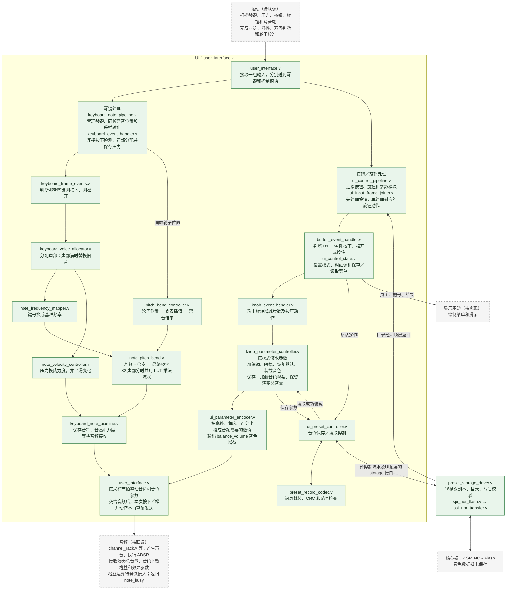
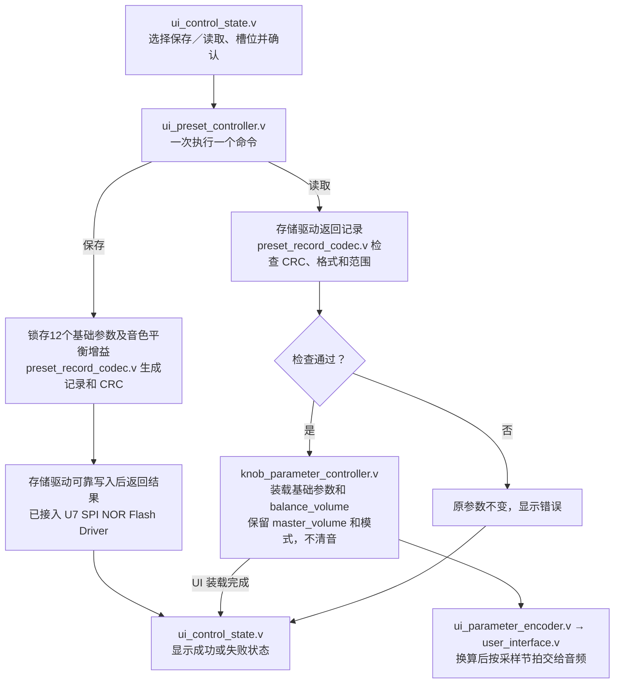

# UI 模块交接说明

**v4 修改（2026-10-26，工作副本）：**

- 新增弯音功能
- 算法为 **最终频率 = 基频 × 2^(音分/1200)**。倍率查表并插值，乘法采用 LUT 分段流水。（使用DSP或者ROM IP还是出现时序违例）
- 增加pll约束到PLL_R[0]，见工程cst文件
- 时序约束报告

| 检查项 | v4 最差裕量 |
| --- | ---: |
| Setup | +0.606 ns |
| Hold | +0.148 ns |
| Recovery | +6.215 ns |
| Removal | +0.261 ns |
| Minimum Pulse Width | +0.221 ns |

**v3修改（2026-10-22）：** 
1、新增音色读取与保存**交互设置**功能；实际存储、读取清音仍未实现。
2、时序约束报告
检查项	当前最差裕量
Setup：	+0.547 ns	
Hold：	+0.148 ns	
Recovery：	+5.448 ns	
Removal：	+0.455 ns	
Minimum Pulse Width：	+0.222 ns

**v2 修改：**

- `keyboard_note_pipeline.v`：采样装载与结果确认分拍。
- `note_velocity_controller.v`：压力选取与最低值判断分拍。
- `note_frequency_mapper.v`：去掉装载使能中重复的复位判断。
- `ui_input_frame_joiner.v`：单独判断协议错误，报错时刻不变。
- `ui_preset_controller.v`：去掉内部命令／响应接收中重复的复位门控，公共接口和握手拍数不变；修改前 +0.090 ns 基准已备份。

## 1. 输入数据和动作是什么意思

**一帧输入，就是驱动一次交给 UI 的一组数据。**

| 连续收到的琴键状态 | UI 的处理 |
| --- | --- |
| 松开 → 按住 | 触发一次新音 |
| 按住 → 按住 | 不重复起音，只根据压力调整力度 |
| 按住 → 松开 | 通知音频进入释放阶段 |

旋钮有所不同：当前约定 `knob_states[i]=1` 表示**这次有一步转动**。连续两组输入都为 1，就是两步，不是持续转动状态。机械一格对应多少 AB 变化仍需驱动负责人确认。“帧”是数据的分组，不是时间单位，也不等于音频采样点。

## 2. 系统架构

从上到下为 **驱动 → UI → 音频**。UI 中琴键处理与按钮／旋钮处理并行；按钮与旋钮之间有先后要求。图中绿色为已实现，虚线框为待联调。

基频、弯音倍率和压力平滑并行计算；全部声部的最终频率和力度均完成后才交付。`note_busy` 是音频返回给 UI 的声部忙闲状态。图中绿色表示逻辑已实现，不表示完整实物演奏系统已验证。存储 Driver 与 UI 在系统 top 平级例化；U7 灯状态存储测试已由用户确认实物正常，UI存取链路已通过仿真。

**同一次输入先处理按钮，再处理旋钮。** 例如 B4 已按住且旋钮转动，先确定微调，再按微调步长修改参数。琴键与参数分别计算；同一次输入的新音与新音色，当前不保证在同一个音频采样点生效。

### 每个文件做什么

| 文件 | 功能 |
| --- | --- |
| `user_interface.v` | UI 顶层，接收驱动数据，向音频输出音符及参数 |
| `keyboard_note_pipeline.v` | 连接琴键处理模块，按采样节拍安排输出 |
| `keyboard_event_handler.v` | 连接琴键动作检测和声部分配，同时保存本次压力 |
| `keyboard_frame_events.v` | 比较前后状态，判断琴键刚按下和刚松开 |
| `keyboard_voice_allocator.v` | 为琴键分配声部，满声部时替换旧音，防止旧键误停新音 |
| `note_frequency_mapper.v` | 查表把键号换成 C4～B5 的频率，A4=440 Hz |
| `pitch_bend_controller.v` | 将轮子位置换成弯音倍率，257 个节点查表并线性插值 |
| `note_pitch_bend.v` | 基频乘倍率，使用四个 16×9 位 LUT 局部乘法，合并后舍入／饱和 |
| `note_velocity_controller.v` | 设置每个音符的力度：最低 5%、按住时平滑、松开后保持 |
| `ui_control_pipeline.v` | 连接按钮、旋钮、参数修改和数值换算模块 |
| `ui_input_frame_joiner.v` | 让同一次输入先处理按钮，再处理旋钮，避免用错模式或步长 |
| `button_event_handler.v` | 判断 B1～B4 的按下、松开和按住状态 |
| `ui_control_state.v` | 演奏模式／微调；菜单选项、槽位、确认、取消和结果页 |
| `knob_event_handler.v` | 输出每个旋钮本次增加／减少一步，以及刚按下动作 |
| `knob_parameter_controller.v` | 保存并修改参数，处理粗细调、边界限制和恢复默认 |
| `ui_parameter_encoder.v` | 把毫秒、角度、百分比换成音频模块所需编码 |
| `ui_preset_controller.v` | 锁存保存内容，发起读写，读取成功后装载整组参数 |
| `preset_record_codec.v` | 生成或检查 64 字节记录、CRC、格式和参数范围 |

### 已实现与未实现

| 状态 | 内容 |
| --- | --- |
| 已实现 | 单音／复音所需的 UI 通知、24 键／32 声部分配、压力控制力度及平滑；真实声音由音频模块产生 |
| 已实现 | 模式 0／1、粗细调、旋钮按压恢复默认、波形选择与插值、初相、ADSR 参数设置 |
| 已实现 | 输出总音量、混响／延迟／失真／合唱的干湿比；实际音频运算由音频模块完成 |
| 已实现 | 16 槽菜单、确认／取消／结果、读写事务、记录校验、整组装载和显示状态输出 |
| 已实现 | ±200 音分弯音、精确回中；含尾音的占用声部一起弯音，菜单期间继续有效 |
| 已实现 | U7 Flash Driver及UI接线、16槽双副本保存／读取、启动目录扫描、写后校验和失败保持原配置 |
| 已实现 | `balance_volume` 音色增益的保存、加载和UI输出，默认100%；`master_volume` 演奏总音量不参与存取 |
| 未实现 | K4调节音色增益、读取清音、模式2、高级音效参数、多通道编辑和菜单屏幕绘制 |
| 待联调 | 琴键／旋钮／弯音轮采集驱动、音频接收和忙闲反馈；完整UI演奏系统尚待上板联调 |

### 音色保存和读取怎样运行

演奏界面按 B1 打开菜单；菜单内 B2／B3 选择、B1 确认、B4 返回或取消。槽位显示 01～16，执行读写后等待结果，期间不能重复确认或取消。菜单期间暂停旋钮编辑，琴键处理继续运行。 本轮K4仍不调节增益，高级菜单仍提示未实现；加载的音色增益可以再次保存。当前记录为64字节、版本3、13项字段，旧版本或灯测试记录读取会报错并保留当前配置。系统复位后重新扫描目录，音色由菜单手动读取，不自动加载。

## 3. 对外接口重点

### 驱动 → UI

| 输入 | 含义 |
| --- | --- |
| `key_states`、`key_velocity` | 哪些琴键按住、各键压力多大；压力为 16 位 UQ0.16，由驱动先校准 |
| `bend_value[0]` | 16 位校准位置：`0000/8000/FFFF` 对应 −200/0/+200 音分；与琴键同帧交付，不接轮子时接 `8000` |
| `button_states` | B1～B4 是否按住，bit 0～3 对应 B1～B4 |
| `knob_states/knob_dirs/knob_pressed` | 本次是否转动一步、方向、是否按住；bit 0～7 对应 K1～K8 |
| `in_valid/in_ready` | 驱动已备好一整组输入、UI 可以接收；两者在系统时钟上升沿同时为 1 时接收一次 |

等待接收时，驱动必须保持 `in_valid` 和这一组输入不变。新发生的动作由驱动暂存，不能覆盖未接收的数据。输入不要求与 `scan_tick_up` 同拍；扫描脉冲可以用于驱动启动扫描。

### UI → 音频，以及音频反馈

| 接口 | 含义 |
| --- | --- |
| 输出 `note_on/note_off` | 各声部开始发声／开始释放的通知，只在输出握手时处理一次 |
| 输出 `note_freq/note_velocity` | 各声部弯音后的最终频率和压力音量，分别为 32 位 UQ16.16、16 位 UQ0.16；压力音量不包含总音量和 ADSR |
| 输出 `wavetable_0/1`、`wavetable_interp`、`init_phase` | 两种波形编号、混合比例和初相；编号 0～3，插值为 UQ1.15，初相为 UQ0.16 |
| 输出 `attack_ticks/decay_ticks/release_ticks`、`sustain_level` | ADR 三段时间及 Sustain 保持音量；时间是 **20 位采样周期数**，保持音量为 16 位 UQ0.16 |
| 输出 `master_volume` | **总音量**，控制整体声音大小 |
| 输出 `reverb_mix/delay_mix/distortion_mix/chorus_mix` | **混响、延迟、失真、合唱的干湿比**，控制原声和效果声的混合比例 |
| 输入 `note_busy` | 音频返回每个声部是否仍在发声，包含松键后的尾音；具体更新规则待确认 |
| `out_valid/out_ready` | UI 数据已备好、音频可以接收；同一系统时钟上升沿都为 1 时整组接收一次 |

**弯音不额外产生 `note_on/note_off`。** 音频按握手更新频率，不因频率变化重新起音或重置相位；采样 tick 启动 UI 计算，不能要求 UI 当拍交付，也不能按旧第 7 拍直接读取。

总音量和四个干湿比均为 16 位 UQ0.16，UI 的 100% 输出 `16'hFFFF`，略小于数学上的 1；波形插值的 100% 为 `16'h8000`，可精确表示 1。音频端负责增益、混合及必要的平滑处理。

### UI ↔ 存储（仅交互，实际存储模块未完成）

接口
**注意！：通信的握手规则与原来一致，只是为了区分“音频接口”和“存储接口”，信号名字不同。**
| 信号 | 方向／位宽 |  含义|
| --- | --- | --- |
| **`storage_out_valid`** | 输出，1 位 | 通信 |
| **`storage_out_ready`** | 输入，1 位 | 通信 |
| **`storage_in_valid`** | 输入，1 位 | 通信 |
| **`storage_in_ready`** | 输出，1 位 | 通信 |
| `storage_out_write` | 输出，1 位 | 1＝保存，0＝读取 |
| `storage_out_slot` | 输出，4 位 | 槽号 0～15，对应屏幕上的 01～16；
| `storage_out_data` | 输出，512 位 | 保存的数据 |
| `storage_in_data` | 输入，512 位 | 读取的数据 |
| `storage_in_status` | 输入，3 位 | 0＝成功，1＝空槽（用于读取），2～7＝存储失败；当前 UI 将 2～7 统一显示为驱动错误 |
| `storage_catalog_valid` | 输入，1 位 | 槽位目录已有效；为 0 表示情况未知 |
| `storage_slot_present` | 输入，16 位 | bit i＝1 表示槽 i 有记录；仅在目录有效时使用 |

#### 时钟

- UI 和存储接口都在 **`clk_sys` 上升沿**检查 `valid && ready`，复位接系统 `rst_sys_n`。`scan_tick_up` 用于控件扫描，`smp_tick_up` 用于安排音频输出，**存储请求和响应不需要与它们同拍**。

#### 64 字节保存内容

| 16 位字序号 | 内容（字 n 对应 `record[16*n +: 16]`） |
| --- | --- |
| 0～3 | 标识 `0x5549`、版本 1、槽号 0～15、字段数 18 |
| 4～15 | 左波形、右波形、插值%、初相°、Attack ms、Decay ms、Sustain %、Release ms、混响%、延迟%、失真%、合唱% |
| 16～21 | 六个高级效果参数占位，当前为 0； |
| 22～30 | 保留字段，当前为 0 |
| 31 | 16 位 CRC 校验值 |

### UI → 显示（简单增加一些接口，未实现）

`menu_page/selection/slot/save/result_status` 给出页面、选项、槽号、操作和结果；`menu_slot_known/present` 给出当前槽是否已知、是否有内容。显示模块只负责绘制界面

### 系统连接和配置

- `clk_sys` 为系统时钟；`rst_n` 接 `rst_sys_n`。`scan_tick_up`、`smp_tick_up` 都是单拍使能，不是新的业务时钟；输入按握手接收，采样脉冲安排音频输出。
- `WAVE_SELECT_STEPS` 是 K1 换一张波形要转多少步。**当前默认 0 表示未配置，会阻止正常工作**；合法范围 1～32767，测试用的 4 还不是产品约定。
- `SMP_TICK_FREQ` 是时间换算用的采样率，默认 48000 Hz；必须和音频端一致。
- 压力平滑默认步长 274，在 48 kHz 下满量程变化约 5 ms，后续可调整。
- `configuration_error` 表示配置非法或内部输入配对错误；`sample_overrun` 表示上一组结果还未处理完，又来了采样脉冲。后者复位清除，漏掉的采样不会补发。

### 相对 S1 的变化——需重点同步

| 变化 | 现在怎样做 |  同步|
| --- | --- | --- |
| **启用弯音并明确交付延迟** | 沿用 `bend_value`，中心明确为 `8000`；`note_freq` 改为弯音后的频率，32 声部最早第 106 沿交付 | 驱动校准后**整帧交付**（所有的硬件） |
| **新增音色存储和菜单状态接口** | UI 可以选择 16 槽并发起保存／读取，显示页号、槽号和结果 | 后续完成存储驱动 |
| **ADR 时间的位宽、单位改变** | 从 32 位系统时钟周期改为 **20 位采样周期**。例如 48 kHz 下 5 ms 对应 240 | 音频包络及上层接线同步修改 |
| **新增总音量和四种干湿比输出** | UI 给出整体音量、混响／延迟／失真／合唱的混合比例 | 音频端增加对应输入，并执行增益和效果混合 |
| **新增按钮输入、采样脉冲和错误指示** | `button_states` 接 B1～B4；`smp_tick_up` 安排输出；两个错误信号用于检查运行状态 | 系统顶层补接这些信号 |
| **明确输入要整组交付** | 一次握手接收琴键、压力、按钮、旋钮和弯音轮的数据 | 驱动侧先整理好数据，不直接把几个互不相关的 valid 相与 |
| **旋钮模块不再输出累计参数值** | 原 `knob_value` 改为 `knob_delta`，只表示本次 -1/0/+1 步；参数模块按模式和粗细调累计 | 单独使用 `knob_event_handler.v` 的地方需修改；通过 UI 顶层连接的音频端不接这个内部信号 |
| **键盘事件模块增加压力和声部状态** | 增加压力输入／保存输出，以及 `occupied/held` | 仅直接使用 `keyboard_event_handler.v` 时需要补接；整机通过 UI 顶层连接即可 |

## 4. 待约定的协议

| 需要确认什么 | 当前处理及待定内容 |
| --- | --- |
| 旋钮“一步”怎样识别 | 当前一次输入最多表示每个旋钮一步；需确认每格 AB 变化数、方向和消抖；多步怎样排队发送 |
| 谁整理完整输入，怎样防止漏动作 | 需明确扫描顺序、缓存容量、最长等待时间，以及缓存满时怎样报错；没有动作时也需更新按住状态和压力 |
| 音频什么时候接收和完成 | 音符通知只处理一次；需约定最晚接收时间，以及音频来不及处理时怎样恢复 |
| `note_busy` 何时置位、清零 | 当前只有确认新音开始又结束，才自动回收已松开的声部；新音替换旧音、极短音和 Release=0 的反馈规则须确认 |
| 满声部时怎样重新起音 | 当前优先空闲，其次最早触发的已松开音符，再次最早触发的按住音符；替换时只发新 `note_on`，音频须重启该声部 |
| 采样率与比例编码 | UI 和音频统一 ADR 换算采样率；当前标称 48 kHz，按 50 MHz 输入及 PLL 配置推算约 47971.491 Hz（非实测）。确认干湿比的效果顺序、混合位置及 100% 编码 |
| K1 波形切换步数 | `WAVE_SELECT_STEPS` 值待定 |
| 压力及上电时已按住的控件 | 驱动负责压力校准；首次输入中琴键按住会起音，按钮和旋钮按压只记录初始状态、不触发动作 |
| 弯音轮驱动 | 端点／中心编码已确定；ADC、校准、中心死区、滤波和最大交付间隔待定，UI 暂不附加时间平滑 |
| 存储硬件及清音 | 优先评估 SPI NOR Flash；具体芯片／地址区、掉电保护、超时和读取清音仍待确定 |
 | 
