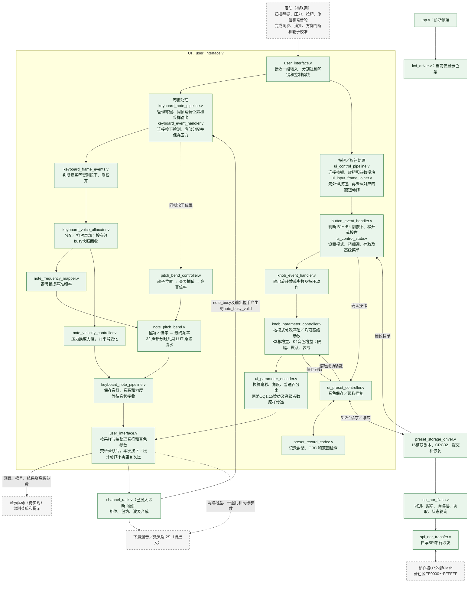
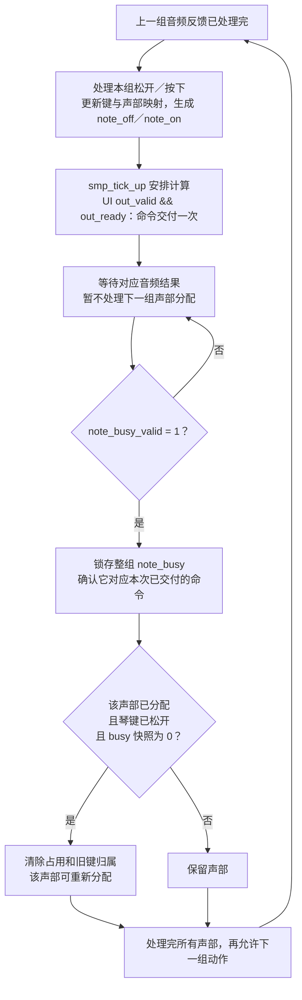
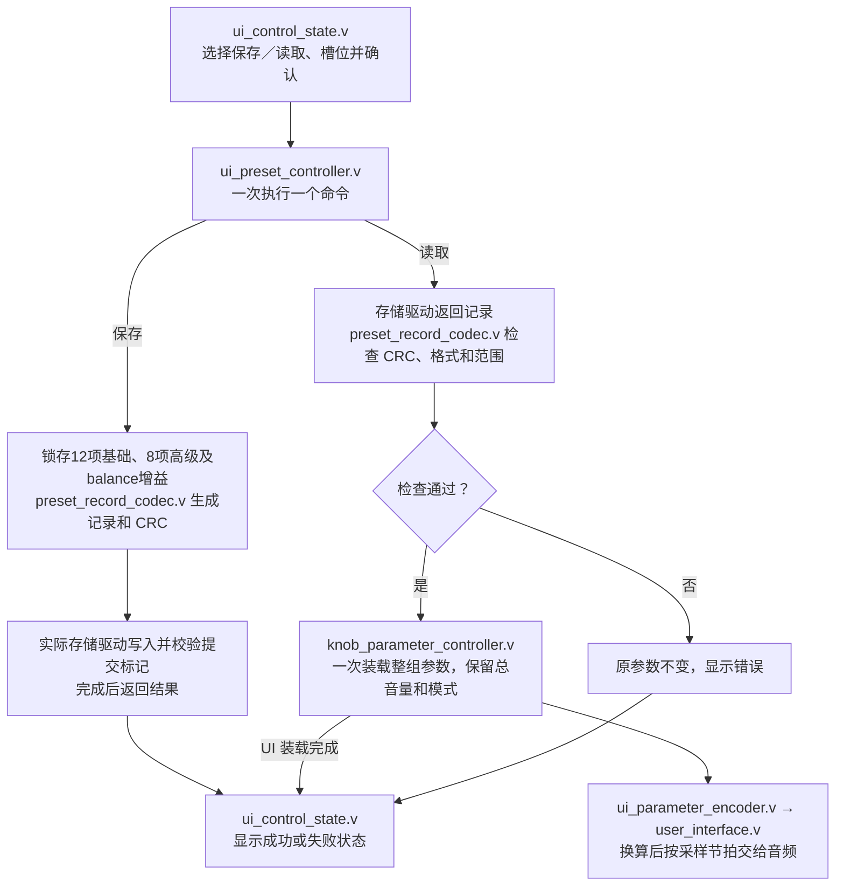

# UI 模块交接说明

**v5更新（2026-10-31）：**


- 实现了音色保存与读取。
- 更新了UI顶层文件。新增s2阶段对应参数。
- `master_volume` 和 `balance_volume` 均为 16 位 **UQ1.15**，范围 **[0.0, 2.0)**，上电／复位及旋钮按压默认均为 **1.0（`16'h8000`）**。
- K3 调总增益，K4 调音色增益；只保存和加载 `balance_volume`。
- 菜单 B1～B4 来自外接按钮模块，`button_driver` 尚未开发；UI 保留 `button_states` 输入。当前诊断顶层将按钮状态置 0，仿真由 TB 注入，板载 K16 仅用于低有效复位。

**v4 修改（2026-10-26，工作副本）：**

- 新增弯音功能
- 算法为 **最终频率 = 基频 × 2^(音分/1200)**。倍率查表并插值，乘法采用 LUT 分段流水。（使用DSP或者ROM IP还是出现时序违例）
- 增加pll约束到PLL_R[0]，见工程cst文件
- 时序约束报告

| 检查项 | v4 最差裕量 |
| --- | ---: |
| Setup | +0.606 ns |
| Hold | +0.148 ns |
| Recovery | +6.215 ns |
| Removal | +0.261 ns |
| Minimum Pulse Width | +0.221 ns |


**v3修改（2026-10-22）：** 
1、新增音色读取与保存**交互设置**功能；实际存储、读取清音仍未实现。
2、时序约束报告
检查项	当前最差裕量
Setup：	+0.547 ns	
Hold：	+0.148 ns	
Recovery：	+5.448 ns	
Removal：	+0.455 ns	
Minimum Pulse Width：	+0.222 ns


**v2 修改：**

- `keyboard_note_pipeline.v`：采样装载与结果确认分拍。
- `note_velocity_controller.v`：压力选取与最低值判断分拍。
- `note_frequency_mapper.v`：去掉装载使能中重复的复位判断。
- `ui_input_frame_joiner.v`：单独判断协议错误，报错时刻不变。
- `ui_preset_controller.v`：去掉内部命令／响应接收中重复的复位门控，公共接口和握手拍数不变；修改前 +0.090 ns 基准已备份。


## 1. 输入数据和动作是什么意思

**一帧输入，就是驱动一次交给 UI 的一组数据。**

| 连续收到的琴键状态 | UI 的处理 |
| --- | --- |
| 松开 → 按住 | 触发一次新音 |
| 按住 → 按住 | 不重复起音，只根据压力调整力度 |
| 按住 → 松开 | 通知音频进入释放阶段 |

旋钮有所不同：当前约定 `knob_states[i]=1` 表示**这次有一步转动**。连续两组输入都为 1，就是两步，不是持续转动状态。机械一格对应多少 AB 变化仍需驱动负责人确认。“帧”是数据的分组，不是时间单位，也不等于音频采样点。

## 2. 系统架构

从上到下为 **驱动 → UI → 音频**。UI 中琴键处理与按钮／旋钮处理并行；按钮与旋钮之间有先后要求。图中绿色为已接入的逻辑，虚线框为待接入或待联调部分；绿色不代表已完成整机上板验证。




**同一次输入先处理按钮，再处理旋钮。** 例如 B4 已按住且旋钮转动，先确定微调，再按微调步长修改参数。琴键与参数分别计算；同一次输入的新音与新音色，当前不保证在同一个音频采样点生效。

### 每个文件做什么

| 文件 | 功能 |
| --- | --- |
| `user_interface.v` | UI 顶层，接收驱动数据，向音频输出音符及参数 |
| `keyboard_note_pipeline.v` | 缓存一组输入，按采样节拍输出；命令交付后等待对应反馈与回收结束，再处理下一组键动作 |
| `keyboard_event_handler.v` | 连接琴键动作检测和声部分配，同时保存本次压力 |
| `keyboard_frame_events.v` | 比较前后状态，判断琴键刚按下和刚松开 |
| `keyboard_voice_allocator.v` | 为琴键分配声部，满声部时替换旧音；按有效快照回收已松开且不忙的声部，防止旧键误停新音 |
| `note_frequency_mapper.v` | 查表把键号换成 C4～B5 的频率，A4=440 Hz |
| `pitch_bend_controller.v` | 将轮子位置换成弯音倍率，257 个节点查表并线性插值 |
| `note_pitch_bend.v` | 基频乘倍率，使用四个 16×9 位 LUT 局部乘法，合并后舍入／饱和 |
| `note_velocity_controller.v` | 设置每个音符的力度：最低 5%、按住时平滑、松开后保持 |
| `ui_control_pipeline.v` | 连接按钮、旋钮、参数修改和数值换算模块 |
| `ui_input_frame_joiner.v` | 让同一次输入先处理按钮，再处理旋钮，避免用错模式或步长 |
| `button_event_handler.v` | 判断 B1～B4 的按下、松开和按住状态 |
| `ui_control_state.v` | 演奏模式／微调；主菜单、槽位、确认、等待、结果、效果列表及编辑页 |
| `knob_event_handler.v` | 输出每个旋钮本次增加／减少一步，以及刚按下动作 |
| `knob_parameter_controller.v` | 基础参数、K3/K4 的 UQ1.15 增益和八项高级参数；粗细调、限幅、默认及整组加载 |
| `ui_parameter_encoder.v` | 换算毫秒、角度、普通百分比；两路 UQ1.15 增益和高级参数原样经过快照流水 |
| `ui_preset_controller.v` | 锁存保存内容，发起读写，读取成功后装载整组参数 |
| `preset_record_codec.v` | 生成格式 5 的 64 字节记录，检查 CRC／格式／范围；读取格式 3/4 时转换旧增益 |

UI、琴键、按钮、旋钮事件、存取控制与记录编解码统一位于正式 `src/ui/`；底层存储驱动位于 `src/drivers/`。

| 配套文件 | 功能 |
| --- | --- |
| `src/drivers/preset_storage_driver.v` | 保存 UI 的 512 位记录；16 槽、双副本、序号、CRC32、写后校验和掉电恢复 |
| `src/drivers/spi_nor_flash.v` | JEDEC/SFDP 识别、读取、4 KiB 擦除、页编程、忙状态轮询及超时 |
| `src/drivers/spi_nor_transfer.v` | 自写 SPI 收发与 MISO 同步 |
| `src/top.v` | 连接 UI、真实机架和存储驱动，产生有效 busy 反馈；独立 Flash 灯光测试已移除 |
| `src/lcd/lcd_driver.v` | 简单LCD 驱动。未完成 |

### 已实现与未实现

| 状态 | 内容 |
| --- | --- |
| 已实现 | 单音／复音所需的 UI 通知、24 键／32 声部分配、压力控制力度及平滑；真实声音由音频模块产生 |
| 已实现 | 模式 0／1、粗细调、旋钮按压恢复默认、波形选择与插值、初相、ADSR 参数设置 |
| 已实现 | K3 总增益、K4 音色增益，均为 UQ1.15；四种干湿比及八项高级参数编辑、默认、输出和存取 |
| 已实现 | 16 槽菜单、确认／取消／结果、读写事务、记录校验、整组装载和显示状态输出 |
| 已实现 | ±200 音分弯音、精确回中；含尾音的占用声部一起弯音，菜单期间继续有效 |
| 已实现 | 解决了复音32通道以上时的通道回收问题 |
| 已实现 | 顶层接入实际 Flash 驱动，16 槽双副本保存／读取；|
| 未实现 | LCD 模块 |
| 待联调 | 实际控件驱动（含弯音轮采集／校准／滤波）、完整音频链及 UI 整机上板；增益改动后需重新综合、布局布线与 STA |

### 声部回收


#### 信号从哪里来

系统顶层连接如下，名称中的 `rack_*` 是顶层连线名：

```verilog

assign note_busy_valid = rack_out_valid && rack_out_ready;

```





下面表示同一声部由 C4 改播 D4；各列是选取的系统时钟沿，中间省略了计算周期。t6、t7 对应的无新按键采样输入握手也位于省略部分，并非没有输入就产生结果。`1↑` 表示本列发生一次反馈握手，不表示声音刚开始：

```text
时刻                 t0   t1   t2   t3   t4   t5   t6   t7
动作                 C4   D4命令    D4反馈 D4松键    尾音   结束反馈
UI→音频命令握手       0    1    0    0    1    0    0    0
note_busy            1    1    1    1    1    1    1    0
note_busy_valid      1↑   0    0    1↑   0    1↑   1↑   1↑
UI记录琴键仍按住      1    1    1    1    0    0    0    0
允许回收             0    0    0    0    0    0    0    1
                                                         ↑
                                             锁存后回收该声部
```

t3 的反馈确认 D4 命令已处理，busy 可以始终为 1；t7 才确认 D4 已结束。**不必再要求出现 1→0 边沿**：极短音若在第一次有效反馈时已经结束，只要对应琴键也已松开，同样可以回收。琴键仍按住时保留归属，避免同一按住动作被当成新按键。


### 音色保存和读取怎样运行

演奏界面按 B1 打开菜单；菜单内 B2／B3 选择、B1 确认、B4 返回或取消。槽位显示 01～16，执行读写后等待结果，期间不能重复确认或取消。普通菜单暂停旋钮编辑；高级参数编辑页允许 K1/K2，琴键和弯音继续运行。

| 页面编码 | 页面及已实现操作 |
| --- | --- |
| 0 | 演奏：B1 打开主菜单，B2 切模式 0/1，按住 B4 微调；K3 总增益、K4 音色增益，两种模式均有效 |
| 1 | 主菜单：演奏、音色读取、音色保存、高级音色设置；B2/B3 上下选，B1 确认，B4 返回演奏 |
| 2／3 | 选择 01～16 槽／二次确认；B4 返回上一级 |
| 4／5 | 等待存取完成／显示结果；等待页不重复发命令，结果页 B1 或 B4 回选槽页 |
| 6 | 高级效果列表：混响、延迟、失真、合唱；B2/B3 选，B1 进入，B4 返回主菜单 |
| 7 | K1/K2 调当前效果的两项参数，按压恢复单项默认；B2 选编辑、B3 选恢复默认，恢复项 B1 重置该效果两项参数和干湿比；B4 返回列表 |




## 3. 对外接口重点


### 驱动 → UI

| 输入 | 含义 |
| --- | --- |
| `key_states`、`key_velocity` | 哪些琴键按住、各键压力多大；压力为 16 位 UQ0.16，由驱动先校准 |
| `bend_value[0]` | 16 位校准位置：`0000/8000/FFFF` 对应 −200/0/+200 音分；与琴键同帧交付，不接轮子时接 `8000` |
| `button_states` | B1～B4 是否按住，bit 0～3 对应 B1～B4 |
| `knob_states/knob_dirs/knob_pressed` | 本次是否转动一步、方向、是否按住；bit 0～7 对应 K1～K8 |
| `in_valid/in_ready` | 驱动已备好一整组输入、UI 可以接收；两者在系统时钟上升沿同时为 1 时接收一次 |

等待接收时，驱动必须保持 `in_valid` 和这一组输入不变。新发生的动作由驱动暂存，不能覆盖未接收的数据。输入不要求与 `scan_tick_up` 同拍；扫描脉冲可以用于驱动启动扫描。

### UI → 音频，以及音频反馈

| 接口 | 含义 |
| --- | --- |
| 输出 `note_on/note_off` | 各声部开始发声／开始释放的通知，只在输出握手时处理一次 |
| 输出 `note_freq/note_velocity` | 各声部弯音后的最终频率和压力音量，分别为 32 位 UQ16.16、16 位 UQ0.16；压力音量不包含总音量和 ADSR |
| 输出 `wavetable_0/1`、`wavetable_interp`、`init_phase` | 两种波形编号、混合比例和初相；编号 0～3，插值为 UQ1.15，初相为 UQ0.16 |
| 输出 `attack_ticks/decay_ticks/release_ticks`、`sustain_level` | ADR 三段时间及 Sustain 保持音量；时间是 **20 位采样周期数**，保持音量为 16 位 UQ0.16 |
| 输出 `master_volume` | **演奏总增益**，16 位 UQ1.15，默认 1.0；K3 调节，不参与音色存取 |
| 输出 `balance_volume` | **音色自身增益**，16 位 UQ1.15，默认 1.0；K4 调节，参与音色存取 |
| 输出 `reverb_mix/delay_mix/distortion_mix/chorus_mix` | **混响、延迟、失真、合唱的干湿比**，控制原声和效果声的混合比例 |
| 输入 `note_busy` | 每个声部的包络忙闲状态，包含松键后的 Release；仅在等待对应命令的有效反馈时采集 |
| 输入 `note_busy_valid` | 1 位；系统顶层由 `channel_rack.out_valid && channel_rack.out_ready` 产生，表示本次音频结果对应的 busy 可以采集；须配合上述顺序控制 |
| `out_valid/out_ready` | UI 数据已备好、音频可以接收；同一系统时钟上升沿都为 1 时整组接收一次 |

**弯音不额外产生 `note_on/note_off`。** 音频按握手更新频率，不因频率变化重新起音或重置相位；采样 tick 启动 UI 计算，不能要求 UI 当拍交付，也不能按旧第 7 拍直接读取。

两路增益的接口约定如下，代码中参数库、快照、编码器和 UI 输出均已同步；`*_gain` 是内部接口名，UI 对音频仍使用 `*_volume`。

```verilog
// 输出：16位无符号UQ1.15；真实增益 = 编码 / 32768。
// 范围0000..FFFF，即[0.0,2.0)，最大1.999969482421875。
// 上电／复位／旋钮按压默认8000=1.0；C000=1.5；0000=静音。
output [15:0] master_volume;   // K3演奏总增益，不保存；读取音色成功后保持当前值。
output [15:0] balance_volume;  // K4音色自身增益，随音色保存和加载。

```

K3/K4 粗调每步 **1638 个编码（约 0.05）**，按住 B4 微调每步 **328 个编码（约 0.01）**，加减后限幅至 `0000..FFFF`，不允许回绕。按压恢复 `8000`，优先于同帧转动；两个增益互不覆盖。

四个干湿比、压力和 Sustain 仍为 UQ0.16，100% 为 `FFFF`；波形插值仍限制 `0000..8000`，100% 为 `8000`。两路增益允许超过 1，不能沿用插值的上界。音频端后续接入这两路时，16 位 SQ1.15 样本与 `$signed({1'b0, gain})` 相乘使用 33 位 signed 乘积，恢复小数位应右移 **15**，并做舍入／饱和；其他 UQ0.16 系数仍右移 16。当前诊断顶层未实现这两路增益的音频乘法。

| 高级参数输出 | 格式／单位 | 默认值 |
| --- | --- | --- |
| `reverb_feedback`／`reverb_damping` | 16 位 UQ0.16，当前上限 F000 | B000／2800 |
| `delay_time`／`delay_feedback` | 16 位采样周期数／UQ0.16（上限 F000） | 12000／9000 |
| `distortion_gain`／`distortion_tone` | 16 位 UQ4.12／UQ0.16 | 1000／8000 |
| `chorus_rate`／`chorus_depth` | 16 位 UQ2.14 Hz／8 位采样周期数 | 4000／24 |

表中编码值使用十六进制，采样周期数 12000、24 使用十进制。高级参数输出和音符参数一起按音频握手保持；

### UI ↔ 存储（已接入实际驱动）

接口
**注意！：通信的握手规则与原来一致，只是为了区分“音频接口”和“存储接口”，信号名字不同。**
| 信号 | 方向／位宽 |  含义|
| --- | --- | --- |
| **`storage_out_valid`** | 输出，1 位 | 通信 |
| **`storage_out_ready`** | 输入，1 位 | 通信 |
| **`storage_in_valid`** | 输入，1 位 | 通信 |
| **`storage_in_ready`** | 输出，1 位 | 通信 |
| `storage_out_write` | 输出，1 位 | 1＝保存，0＝读取 |
| `storage_out_slot` | 输出，4 位 | 槽号 0～15，对应屏幕上的 01～16 |
| `storage_out_data` | 输出，512 位 | 保存的数据 |
| `storage_in_data` | 输入，512 位 | 读取的数据 |
| `storage_in_status` | 输入，3 位 | 0＝成功，1＝空槽（用于读取），2～7＝存储失败；当前 UI 将 2～7 统一显示为驱动错误 |
| `storage_catalog_valid` | 输入，1 位 | 槽位目录已有效；为 0 表示情况未知 |
| `storage_slot_present` | 输入，16 位 | bit i＝1 表示槽 i 有记录；仅在目录有效时使用 |


#### 时钟

- UI 和存储接口都在 **`clk_sys` 上升沿**检查 `valid && ready`，复位接系统 `rst_sys_n`。`scan_tick_up` 用于控件扫描，`smp_tick_up` 用于安排音频输出，**存储请求和响应不需要与它们同拍**。


#### 64 字节保存内容


| 16 位字序号 | 内容（字 n 对应 `record[16*n +: 16]`） |
| --- | --- |
| 0～3 | 标识 `0x5549`、版本 5、槽号 0～15、字段数 21 |
| 4～15 | 左波形、右波形、插值%、初相°、Attack ms、Decay ms、Sustain %、Release ms、混响%、延迟%、失真%、合唱% |
| 16～23 | reverb_feedback、reverb_damping、delay_time、delay_feedback、distortion_gain、distortion_tone、chorus_rate、chorus_depth（高 8 位为 0） |
| 24 | balance_volume 的 16 位 UQ1.15 原码，0000～FFFF；不包含 master_volume |
| 25～30 | 保留字段，当前为 0 |
| 31 | 16 位 CRC 校验值 |


### UI → 显示（未完成）

`menu_page/selection/slot/save/result_status` 给出页面、选项、槽号、操作和结果；`menu_slot_known/present` 给出当前槽是否已知、是否有内容。`menu_effect` 指示当前效果，`menu_effect_reset` 指示恢复默认选项，`menu_advanced_parameters[127:0]` 输出八项编辑值。显示模块只负责绘制，当前 LCD 色条尚未使用这些状态。


### 相对 S1 的变化——需重点同步

| 变化 | 现在怎样做 |  同步|
| --- | --- | --- |
| **新增声部状态有效输入（已实现）** | 增加 `note_busy_valid`，按对应命令的有效反馈回收已松开且 busy=0 的声部 | 系统顶层已接机架输出握手，UI 已实现顺序控制和对应测试，音频输入 valid/ready 规则不变 |
| **启用弯音并明确交付延迟** | 沿用 `bend_value`，中心明确为 `8000`；`note_freq` 改为弯音后的频率，32 声部最早第 106 沿交付 | 驱动校准后**整帧交付**（所有的硬件） |
| **新增音色存储** | UI 可以选择 16 槽并发起保存／读取，显示页号、槽号和结果 | 已接入实际驱动； |
| **ADR 时间的位宽、单位改变** | 从 32 位系统时钟周期改为 **20 位采样周期**。例如 48 kHz 下 5 ms 对应 240 | 音频包络及上层接线同步修改 |
| **两路增益及高级参数** | K3 master、K4 balance 均改为 UQ1.15，默认 8000；四个干湿比与八项高级参数独立输出 | 音频端接入两路增益时按 Q15 乘法处理；master 不存取，balance 存取；旧记录转换后加载 |
| **新增按钮输入、采样脉冲和错误指示** | `button_states` 接 B1～B4；`smp_tick_up` 安排输出；两个错误信号用于检查运行状态 | 系统顶层补接这些信号 |
| **明确输入要整组交付** | 一次握手接收琴键、压力、按钮、旋钮和弯音轮的数据 | 驱动侧先整理好数据，不直接把几个互不相关的 valid 相与 |
| **旋钮模块不再输出累计参数值** | 原 `knob_value` 改为 `knob_delta`，只表示本次 -1/0/+1 步；参数模块按模式和粗细调累计 | 单独使用 `knob_event_handler.v` 的地方需修改；通过 UI 顶层连接的音频端不接这个内部信号 |
| **键盘事件模块增加压力和声部状态** | 增加压力输入／保存输出，以及 `occupied/held` | 仅直接使用 `keyboard_event_handler.v` 时需要补接；整机通过 UI 顶层连接即可 |


## 4. 待约定的协议

| 需要确认什么 | 当前处理及待定内容 |
| --- | --- |
| 旋钮“一步”怎样识别 | 当前一次输入最多表示每个旋钮一步；需确认每格 AB 变化数、方向和消抖；多步怎样排队发送 |
| 谁整理完整输入，怎样防止漏动作 | 需明确扫描顺序、缓存容量、最长等待时间，以及缓存满时怎样报错；没有动作时也需更新按住状态和压力 |
| 音频什么时候接收和完成 | 输入握手只交付一次命令；机架输出握手作为有效状态反馈。仍需验证整链最长处理时间、下游背压与采样超时处理 |
| 新回收方案怎样联调 | 顺序控制和反馈回收已实现；核对反馈与命令一一对应、静音继续输出、同步复位，以及极短音／Release=0 的实际包络行为 |
| 满声部时怎样重新起音 | 当前优先空闲，其次最早触发的已松开音符，再次最早触发的按住音符；替换时只发新 `note_on`，音频须重启该声部 |
| 采样率与比例编码 | UI 和音频统一 ADR 换算采样率；当前标称 48 kHz，按 50 MHz 输入及 PLL 配置推算约 47971.491 Hz（非实测）。确认干湿比的效果顺序、混合位置及 100% 编码 |
| K1 波形切换步数 | `WAVE_SELECT_STEPS` 值待定 |
| 压力及上电时已按住的控件 | 驱动负责压力校准；首次输入中琴键按住会起音，按钮和旋钮按压只记录初始状态、不触发动作 |
| 弯音轮驱动 | 端点／中心编码已确定；ADC、校准、中心死区、滤波和最大交付间隔待定，UI 暂不附加时间平滑 |
| 存储硬件及清音 | 已使用核心板 U7 外部 SPI NOR Flash，FE0000～FFFFFF，双副本、提交标记和超时已实现；读取清音仍待与音频模块约定 |
