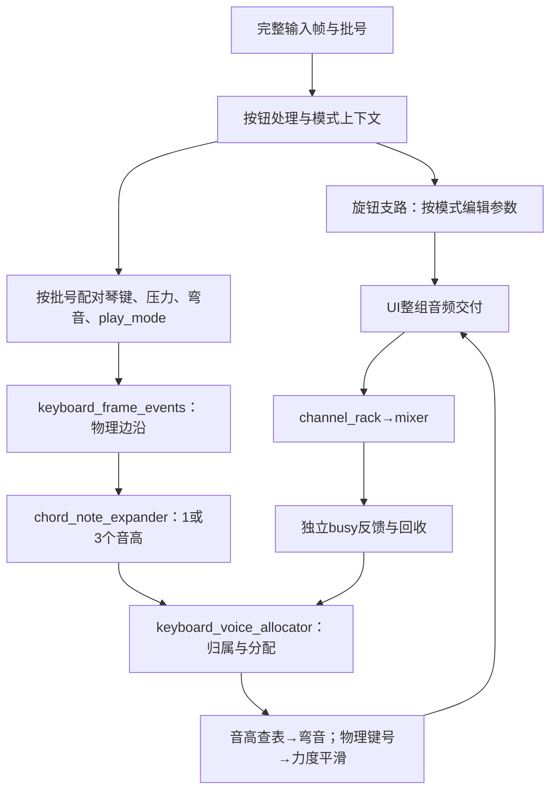

# UI 模块交接说明

2026-11-02 · S2 和弦版，基于远程 dev `403534be`。和弦UI与LCD已按清单移交正式src/；未替换正式顶层、工程或约束。

## 1. 本轮功能

- 普通模式默认一键一音；和弦模式一键生成根音、大三度、纯五度，十二平均律偏移 **0／4／7**。24 个物理键不变，32 个音频声部、1 个音色通道不变。
- 物理键号继续控制压力和松键；独立的 7 位 `note_number` 决定频率。最高物理键 B5 产生 B5／D♯6／F♯6。
- 三音在同一音频命令起音；松键释放该键仍持有的全部声部。已按住的音在模式切换时保持原形，之后的新按键才使用新模式。
- 保留压力下限／平滑、弯音（含尾音）、参数粗细调、16 槽音色协议、两路增益和高级效果设置。
- 已补齐LCD普通／和弦子菜单、选中条及演奏页状态提示；本次移交没有修改高云工程、顶层或约束，也没有运行实现。

和弦三音各继承原压力，不自动把主音量或力度除以3；多音叠加可能削波，输出仍按 mixer 的既有饱和规则处理。固定大三和弦不等于调内自动和声。

## 2. 操作与模式

| 界面 | 操作 |
| --- | --- |
| 演奏页 | B1 打开主菜单；B2 切换整套旋钮工作模式0／1；B3 保留波形／频谱视图状态切换；按住B4微调 |
| 主菜单 | B2／B3 上一项／下一项：演奏模式、音色读取、音色保存、高级效果；B1进入；B4回演奏 |
| 演奏模式子菜单 | 进入时选中当前模式；B2普通、B3和弦；B1确认并回演奏；B4取消并回主菜单。优先级B4→B1→B2→B3 |
| 其他菜单 | 保留原槽位确认、结果及四种效果编辑／恢复默认；菜单不停止琴键和弯音 |

`mode[1:0]` 为旋钮工作模式0／1、高级编辑2；新增 `play_mode` 为普通0／和弦1，互不替代。演奏模式子菜单沿用 `menu_page=1`，另用 `menu_play_mode_active=1` 标识；候选项与已确认值分别保存。

**按钮先确定本帧模式，再交付同批琴键。** B1确认与新按键同帧时按新模式起音；首次输入的琴键按住会起音，首次按钮／旋钮按压仅建立历史。

## 3. 模块与数据路径

| 文件（相对正式根目录） | 本轮接口／逻辑变动 |
| --- | --- |
| `src/ui/chord_note_expander.v` | 新增；输入play_mode与物理事件，输出每键0／1／3个候选及7位音高 |
| `src/ui/keyboard_voice_allocator.v` | 增加tone_count／tone_note输入、note_number输出；一次扫描预选三候选、分组提交、同帧预留保护 |
| `src/ui/keyboard_event_handler.v` | 增加play_mode／note_number，插入扩展器；压力仍按24个物理键保存 |
| `src/ui/keyboard_note_pipeline.v` | 同帧缓存模式，分别保存物理归属与音高；保持命令／反馈／回收顺序 |
| `src/ui/note_frequency_mapper.v` | 输入由key_id改为7位note_number，MIDI60～90共31项；原24音编码不变 |
| `src/ui/ui_control_state.v` | 普通／和弦子菜单及已确认模式，原工作模式与B4微调不变 |
| `src/ui/ui_input_frame_joiner.v` | 输出本次按钮的批号handler_button_batch_id |
| `src/ui/ui_control_pipeline.v` | 模式context独立分发给旋钮和琴键；逐支路确认，按钮预取不能覆盖旧批号 |
| `src/ui/user_interface.v` | 同批模式／琴键配对，批号错误锁存configuration_error；音频公共端口不变 |

全部改动模块的文件头标记了2026-11-02接口、逻辑与时序变动。音频目录、mixer及厂商IP业务源码沿用dev。

## 4. 公共接口和握手

| 边界 | 约定 |
| --- | --- |
| 驱动／调用者→UI | `in_valid && in_ready` 同时接收琴键状态、24项16位UQ0.16压力、按钮、旋钮和弯音；不能把多个无关valid简单相与 |
| 弯音 | `bend_value[0]` 的0000／8000／FFFF为−200／0／+200音分；每次从基频计算，不累计乘旧频率 |
| UI→音频 | 同一握手交付32位note_on／note_off、32项UQ16.16频率与UQ0.16力度，以及音色／效果参数；等待时整组保持 |
| 音频→UI | 独立的note_busy[31:0]、note_busy_valid／note_busy_ready；对应命令交付后接收，逐路回收完成后才开始下一次分配 |
| UI→显示 | 原528位display_out_state及valid／ready；显示背压不阻塞业务，未发送状态可合并、活动／复位事件按原规则保留 |
| UI↔存储 | 原512位请求／响应、0～15槽号、状态码与目录接口不变；play_mode不保存，master不保存，balance保存 |

所有业务均在 `clk_sys` 上升沿握手，`rst_n` 接 `rst_sys_n`。`scan_tick_up`、`smp_tick_up` 是使能事件，不是新时钟。ADSR时间为20位采样周期数；master／balance均为16位UQ1.15、默认8000；插值仍为UQ1.15、上限8000；干湿比和压力仍为UQ0.16。

新增内部接口：`keyboard_context_valid/ready`、32位`keyboard_context_batch_id`、1位`keyboard_context_play_mode`。一份按钮context分别记录旋钮／琴键支路是否接收；各支路只消费一次，批号从0起自然回绕，共同复位。不能简单广播valid并把ready相与。

## 5. 声部分配与事件语义

1. 每帧先松键，再按物理键号递增处理新按键；每组需1或3路，三个候选互异。
2. 优先最低编号空闲，其次最老已松开声部，最后最老按住声部；同级同龄取低号。内部年龄按逐次提交更新，不使用过期年龄。
3. 本帧刚分配的声部不得再被抢占；不足整组就跳过该新按键，已有松键仍然生效。32路同帧最多接纳10组三音；被跳过的键需松开重按。不同帧仍可抢占旧音，因此后续第11个键可以起音。
4. 抢占以声部为单位，旧和弦可能只剩部分音；新note_on重置相位和包络，并清除同路旧note_off。不同声部的on／off可以同时交付；同一声部on优先。
5. 同键重按时，旧尾音held=0，新音held=1；旧键不能释放已换归属的声部。不同键生成的相同音高仍独立占用声部。
6. 松键不立即空闲。有效反馈确认`occupied && !held && !busy`后回收；旧busy=0不能提前回收尚未交付的新音。

内部按事件握手锁存全部候选，处理中不接另一帧；完成后才发布整组归属和音高。原106沿仅描述采样后的频率／弯音链，不代表输入到发声的总延迟。

## 6. 显示扩展与范围边界

| 528位快照 | 含义 |
| --- | --- |
| bit509 | play_mode：0普通／1和弦 |
| bit510 | 演奏模式子菜单有效 |
| bit511 | 子菜单候选：0普通／1和弦 |

其余字段位置不变，三个位是状态覆盖而非事件OR。`ui_interaction`和`drawers`已接受新字段；仅子菜单标志为1而page不是1时报协议错误。候选保留在其他页面是合法状态，不能当成保留位错误。

`lcd_page_program`在page=1且bit510=1时绘制两项Normal mode／Chord mode，演奏页右上显示Normal / 1 note或Chord / 3 notes；B1确认、B2普通、B3和弦、B4返回。候选选中条与bit511一致，取消不改变已确认模式。

绘图协议新增`scene_config[24]`为子菜单身份，`[5:4]`为0／1候选，`[31:25]`继续为0；**原[23]保存上下文保留**。`lcd_scene`将{page,submenu}作为页面身份，主菜单与子菜单互换立即定位，子菜单内部仍六帧移动。字库只追加string143～152，原编号不变；tile共2048项。

LCD与整机接口的移交范围、验证入口和模型边界见[S2和弦移交说明.md](S2和弦移交说明.md)。

读取音色强制清音、响度补偿、无点击声抢占仍未实现。本次没有调整正式top的旋钮／弯音输入、压力硬件接线或存储行为。

## 7. 正式回归入口

ModelSim当前目录为正式`sim/`：

- UI／和弦／32声部：`do do/ui/run_chord.do`。
- LCD／实际正式top：`do do/lcd_ui/run_chord_lcd.do`；整机长窗口可单独执行`run_chord_system.do`。
- 库、日志与波形生成在`ai_workspace/sim/work_formal_*/results/`，源码与测试资源均从正式目录读取。

保留旧S1向量入口用于回溯；新分组策略和模式菜单以以上回归为准，不承诺旧固定周期／超额按键向量继续适用。

高云工程按先前要求未改。新增`src/ui/chord_note_expander.v`须在后续综合前加入GPRJ，MPF图形项目同理；DO入口已显式包含，不依赖GPRJ或MPF。当前启用的测试顶层／约束保持原样，不能把现有位流当成本版结果。
