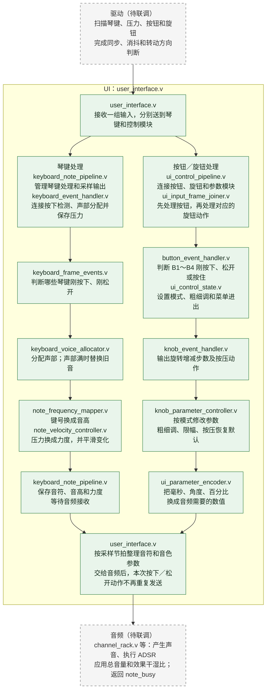

# UI 模块交接说明

## 1. 输入数据和动作是什么意思

**一帧输入，就是驱动一次交给 UI 的一组数据。**

| 连续收到的琴键状态 | UI 的处理 |
| --- | --- |
| 松开 → 按住 | 触发一次新音 |
| 按住 → 按住 | 不重复起音，只根据压力调整力度 |
| 按住 → 松开 | 通知音频进入释放阶段 |

旋钮有所不同：当前约定 `knob_states[i]=1` 表示**这次有一步转动**。连续两组输入都为 1，就是两步，不是持续转动状态。机械一格对应多少 AB 变化仍需驱动负责人确认。“帧”是数据的分组，不是时间单位，也不等于音频采样点。

## 2. 系统架构

从上到下为 **驱动 → UI → 音频**。UI 中琴键处理与按钮／旋钮处理并行；按钮与旋钮之间有先后要求。图中绿色为已实现，虚线框为待联调。

音高换算和压力平滑实际上同时计算。`note_busy` 是音频返回给 UI 的声部忙闲状态

**同一次输入先处理按钮，再处理旋钮。** 例如 B4 已按住且旋钮转动，先确定微调，再按微调步长修改参数。琴键与参数分别计算；同一次输入的新音与新音色，当前不保证在同一个音频采样点生效。

### 每个文件做什么

| 文件 | 功能 |
| --- | --- |
| `user_interface.v` | UI 顶层，接收驱动数据，向音频输出音符及参数 |
| `keyboard_note_pipeline.v` | 连接琴键处理模块，按采样节拍安排输出 |
| `keyboard_event_handler.v` | 连接琴键动作检测和声部分配，同时保存本次压力 |
| `keyboard_frame_events.v` | 比较前后状态，判断琴键刚按下和刚松开 |
| `keyboard_voice_allocator.v` | 为琴键分配声部，满声部时替换旧音，防止旧键误停新音 |
| `note_frequency_mapper.v` | 查表把键号换成 C4～B5 的频率，A4=440 Hz |
| `note_velocity_controller.v` | 设置每个音符的力度：最低 5%、按住时平滑、松开后保持 |
| `ui_control_pipeline.v` | 连接按钮、旋钮、参数修改和数值换算模块 |
| `ui_input_frame_joiner.v` | 让同一次输入先处理按钮，再处理旋钮，避免用错模式或步长 |
| `button_event_handler.v` | 判断 B1～B4 的按下、松开和按住状态 |
| `ui_control_state.v` | B2 切模式，B4 微调，B1 进菜单、B4 返回 |
| `knob_event_handler.v` | 输出每个旋钮本次增加／减少一步，以及刚按下动作 |
| `knob_parameter_controller.v` | 保存并修改参数，处理粗细调、边界限制和恢复默认 |
| `ui_parameter_encoder.v` | 把毫秒、角度、百分比换成音频模块所需编码 |

### 已实现与未实现

| 状态 | 内容 |
| --- | --- |
| 已实现 | 单音、多音演奏，24 键／32 声部分配，压力控制力度及平滑 |
| 已实现 | 模式 0／1、粗细调、旋钮按压恢复默认、波形选择与插值、初相、ADSR 参数设置 |
| 已实现 | 输出总音量、混响／延迟／失真／合唱的干湿比；实际音频运算由音频模块完成 |
| 部分实现 | 菜单只实现进入、返回及暂停旋钮编辑，尚不能选择和执行菜单项目 |
| 未实现 | 弯音、16 槽音色保存读取、读取时停音、完整菜单、模式 2、高级音效参数、多通道编辑、显示接口 |
| 待联调 | 实际驱动、音频接收和忙闲反馈；尚未上板 |

## 3. 对外接口重点

对接文件为 **`ui/user_interface.v`**。下面只列连接时需要理解的重点，完整声明直接看该文件。

### 驱动 → UI

| 输入 | 含义 |
| --- | --- |
| `key_states`、`key_velocity` | 哪些琴键按住、各键压力多大；压力为 16 位 UQ0.16，由驱动先校准 |
| `button_states` | B1～B4 是否按住，bit 0～3 对应 B1～B4 |
| `knob_states/knob_dirs/knob_pressed` | 本次是否转动一步、方向、是否按住；bit 0～7 对应 K1～K8 |
| `in_valid/in_ready` | 驱动已备好一整组输入、UI 可以接收；两者在系统时钟上升沿同时为 1 时接收一次 |

等待接收时，驱动必须保持 `in_valid` 和这一组输入不变。新发生的动作由驱动暂存，不能覆盖未接收的数据。输入不要求与 `scan_tick_up` 同拍；扫描脉冲可以用于驱动启动扫描。

### UI → 音频，以及音频反馈

| 接口 | 含义 |
| --- | --- |
| 输出 `note_on/note_off` | 各声部开始发声／开始释放的通知，只在输出握手时处理一次 |
| 输出 `note_freq/note_velocity` | 各声部音高和压力音量，分别为 32 位 UQ16.16、16 位 UQ0.16；压力音量不包含总音量和 ADSR |
| 输出 `wavetable_0/1`、`wavetable_interp`、`init_phase` | 两种波形编号、混合比例和初相；编号 0～3，插值为 UQ1.15，初相为 UQ0.16 |
| 输出 `attack_ticks/decay_ticks/release_ticks`、`sustain_level` | ADR 三段时间及 Sustain 保持音量；时间是 **20 位采样周期数**，保持音量为 16 位 UQ0.16 |
| 输出 `master_volume` | **总音量**，控制整体声音大小 |
| 输出 `reverb_mix/delay_mix/distortion_mix/chorus_mix` | **混响、延迟、失真、合唱的干湿比**，控制原声和效果声的混合比例 |
| 输入 `note_busy` | 音频返回每个声部是否仍在发声，包含松键后的尾音；具体更新规则待确认 |
| `out_valid/out_ready` | UI 数据已备好、音频可以接收；同一系统时钟上升沿都为 1 时整组接收一次 |

总音量和四个干湿比均为 16 位 UQ0.16，UI 的 100% 输出 `16'hFFFF`，略小于数学上的 1；波形插值的 100% 为 `16'h8000`，可精确表示 1。音频端负责增益、混合及必要的平滑处理。

### 系统连接和配置

- `clk_sys` 为系统时钟；`rst_n` 接 `rst_sys_n`。`smp_tick_up` 每个采样周期触发一次计算
- `WAVE_SELECT_STEPS` 是 K1 换一张波形要转多少步。**当前默认 0 表示未配置，会阻止正常工作**；合法范围 1～32767，测试用的 4 还不是产品约定。
- `SMP_TICK_FREQ` 是时间换算用的采样率，默认 48000 Hz；必须和音频端一致。
- 压力平滑默认步长 274，在 48 kHz 下满量程变化约 5 ms，后续可调整。
- `configuration_error` 表示配置非法或内部输入配对错误；`sample_overrun` 表示上一组结果还未处理完，又来了采样脉冲。后者复位清除，漏掉的采样不会补发。

### 相对 S1 的变化——需重点同步

| 变化 | 现在怎样做 |  同步|
| --- | --- | --- |
| **ADR 时间的位宽、单位改变** | 从 32 位系统时钟周期改为 **20 位采样周期**。例如 48 kHz 下 5 ms 对应 240 | 音频包络及上层接线同步修改 |
| **新增总音量和四种干湿比输出** | UI 给出整体音量、混响／延迟／失真／合唱的混合比例 | 音频端增加对应输入，并执行增益和效果混合 |
| **新增按钮输入、采样脉冲和错误指示** | `button_states` 接 B1～B4；`smp_tick_up` 安排输出；两个错误信号用于检查运行状态 | 系统顶层补接这些信号 |
| **明确输入要整组交付** | 一次握手接收琴键、压力、按钮和旋钮的数据 | 驱动侧先整理好数据，不直接把几个互不相关的 valid 相与 |
| **旋钮模块不再输出累计参数值** | 原 `knob_value` 改为 `knob_delta`，只表示本次 -1/0/+1 步；参数模块按模式和粗细调累计 | 单独使用 `knob_event_handler.v` 的地方需修改；通过 UI 顶层连接的音频端不接这个内部信号 |
| **键盘事件模块增加压力和声部状态** | 增加压力输入／保存输出，以及 `occupied/held` | 仅直接使用 `keyboard_event_handler.v` 时需要补接；整机通过 UI 顶层连接即可 |

其余 S1 公共接口名称、位宽和数组方向保留。建议使用具名端口连接。初相改变后，现有相位累加器在下次 `note_on` 时加载，不会立即重置正在发声的音符。

## 4. 待约定的协议

| 需要确认什么 | 当前处理及待定内容 |
| --- | --- |
| 旋钮“一步”怎样识别 | 当前一次输入最多表示每个旋钮一步；需确认每格 AB 变化数、方向和消抖；多步怎样排队发送 |
| 谁整理完整输入，怎样防止漏动作 | 需明确扫描顺序、缓存容量、最长等待时间，以及缓存满时怎样报错；没有动作时也需更新按住状态和压力 |
| 音频什么时候接收和完成 | 音符通知只处理一次；需约定最晚接收时间，以及音频来不及处理时怎样恢复 |
| `note_busy` 何时置位、清零 | 当前只有确认新音开始又结束，才自动回收已松开的声部；新音替换旧音、极短音和 Release=0 的反馈规则须确认 |
| 满声部时怎样重新起音 | 当前优先空闲，其次最早触发的已松开音符，再次最早触发的按住音符；替换时只发新 `note_on`，音频须重启该声部 |
| 采样率与比例编码 | UI 和音频统一 ADR 换算采样率；当前标称 48 kHz、实际约 47971.491 Hz。确认干湿比的效果顺序、混合位置及 100% 编码 |
| K1 波形切换步数 | `WAVE_SELECT_STEPS` 值待定 |
| 压力及上电时已按住的控件 | 驱动负责压力校准；首次输入中琴键按住会起音，按钮和旋钮按压只记录初始状态、不触发动作 |
| 后续弯音和音色保存读取 | 需约定弯音中心、存储读写结果、读取时停音及尾音清除；目前没有实现这些功能 |

